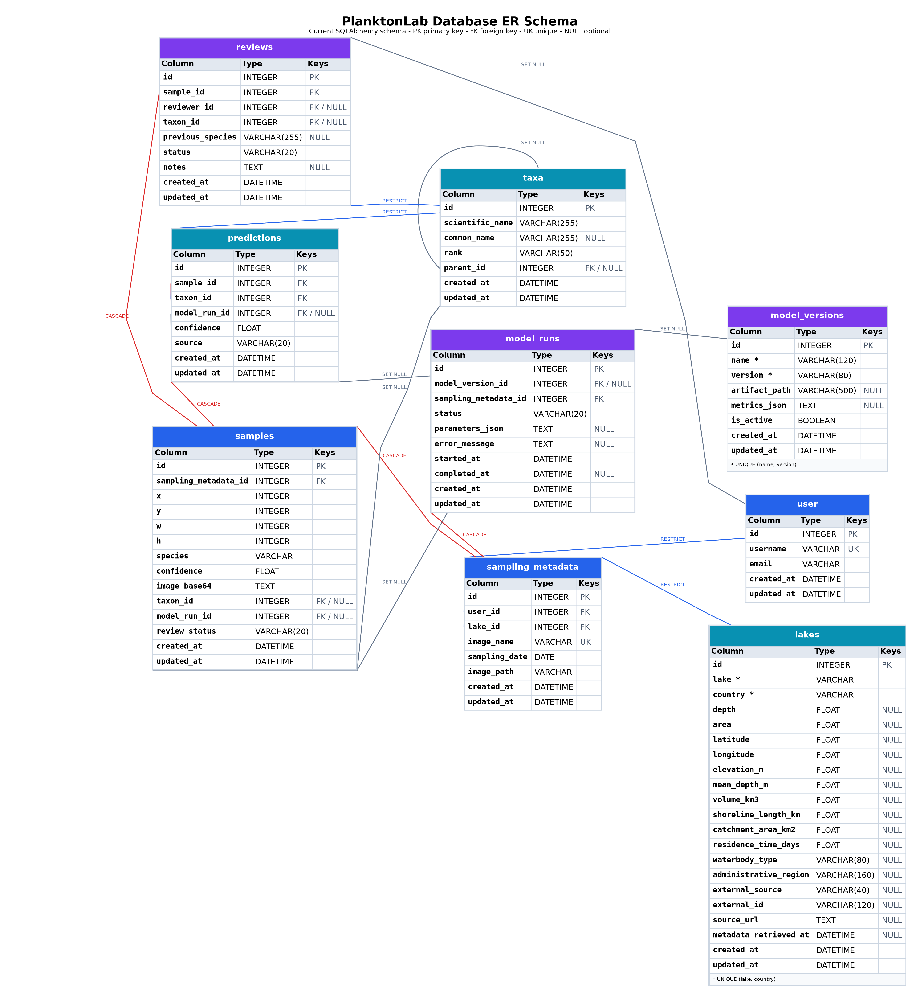
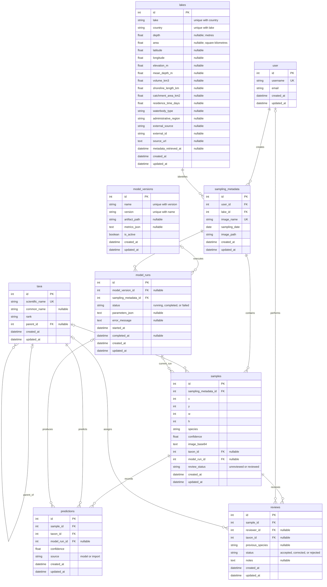

# Database entity-relationship schema

This diagram reflects the current SQLAlchemy models in
`apps/static/assets/utils/database_classes.py`. Optional foreign keys are shown with
`o|`; required foreign keys are shown with `||`. Every table also contains the required
`created_at` and `updated_at` fields supplied by `TimestampMixin`.

The Mermaid source below provides a scalable, editable version of the same schema.

## Delete behavior

| Parent | Child foreign key | Behavior |
| --- | --- | --- |
| `user` | `sampling_metadata.user_id` | Restrict deletion |
| `lakes` | `sampling_metadata.lake_id` | Restrict deletion |
| `taxa` | `taxa.parent_id` | Set child reference to null |
| `model_versions` | `model_runs.model_version_id` | Set reference to null |
| `sampling_metadata` | `model_runs.sampling_metadata_id` | Cascade deletion |
| `sampling_metadata` | `samples.sampling_metadata_id` | Cascade deletion |
| `taxa` | `samples.taxon_id` | Set reference to null |
| `model_runs` | `samples.model_run_id` | Set reference to null |
| `samples` | `predictions.sample_id` | Cascade deletion |
| `taxa` | `predictions.taxon_id` | Restrict deletion |
| `model_runs` | `predictions.model_run_id` | Set reference to null |
| `samples` | `reviews.sample_id` | Cascade deletion |
| `user` | `reviews.reviewer_id` | Set reference to null |
| `taxa` | `reviews.taxon_id` | Restrict deletion |

The database also creates three read-only reporting views:

- `classification_summary` aggregates detections by image and taxon.
- `review_queue` exposes unreviewed detections with their image and lake context.
- `model_run_summary` reports model provenance and prediction counts per run.
