# PlanktonLab user manual

This manual describes the complete desktop workflow for PlanktonLab: preparing a
workspace, importing microscopy images, reviewing detections, managing records,
exploring results, exporting training data, and installing classifier models.

The screenshots use demonstration data. Names, dates, identifiers, and counts in
your workspace will be different.

## Contents

1. [Start PlanktonLab](#1-start-planktonlab)
2. [Complete first-run setup](#2-complete-first-run-setup)
3. [Understand the main workflow](#3-understand-the-main-workflow)
4. [Add or reopen an image](#4-add-or-reopen-an-image)
5. [Detect and edit organisms](#5-detect-and-edit-organisms)
6. [Classify and review results](#6-classify-and-review-results)
7. [Manage database records](#7-manage-database-records)
8. [Add lake metadata](#8-add-lake-metadata)
9. [Explore and export data](#9-explore-and-export-data)
10. [Build a training dataset](#10-build-a-training-dataset)
11. [Train and install a model](#11-train-and-install-a-model)
12. [Data storage, backup, and security](#12-data-storage-backup-and-security)
13. [Troubleshooting](#13-troubleshooting)

## 1. Start PlanktonLab

### Windows

Double-click `planktonlab.cmd`, or run it from Command Prompt. Terminal users can
also run `planktonlab.ps1` from PowerShell.

### macOS

Double-click `planktonlab.command`, or run:

```bash
./planktonlab.command
```

### Linux

Run:

```bash
./planktonlab
```

On the first launch, PlanktonLab downloads its pinned Python runtime and locked
dependencies. Later launches reuse the local environment. The application opens at
<http://127.0.0.1:5000> by default.

Useful launch settings:

| Setting | Purpose |
| --- | --- |
| `PLANKTONLAB_PORT` | Use another port if `5000` is occupied. |
| `PLANKTONLAB_HOST` | Change the listener address. The default is local-only. |
| `PLANKTONLAB_OPEN_BROWSER=false` | Start without opening a browser window. |
| `PLANKTONLAB_DATA_DIR` | Store the database, images, models, and session key in another directory. |
| `PLANKTONLAB_ACCELERATOR=cuda` | Use the CUDA dependency profile on a compatible Linux or Windows computer. |

For development installation behind an organization-managed TLS proxy, use the
operating system certificate store:

```bash
uv --system-certs sync --frozen --extra cpu
```

## 2. Complete first-run setup

An empty workspace requires one operator and one lake before images can be added.

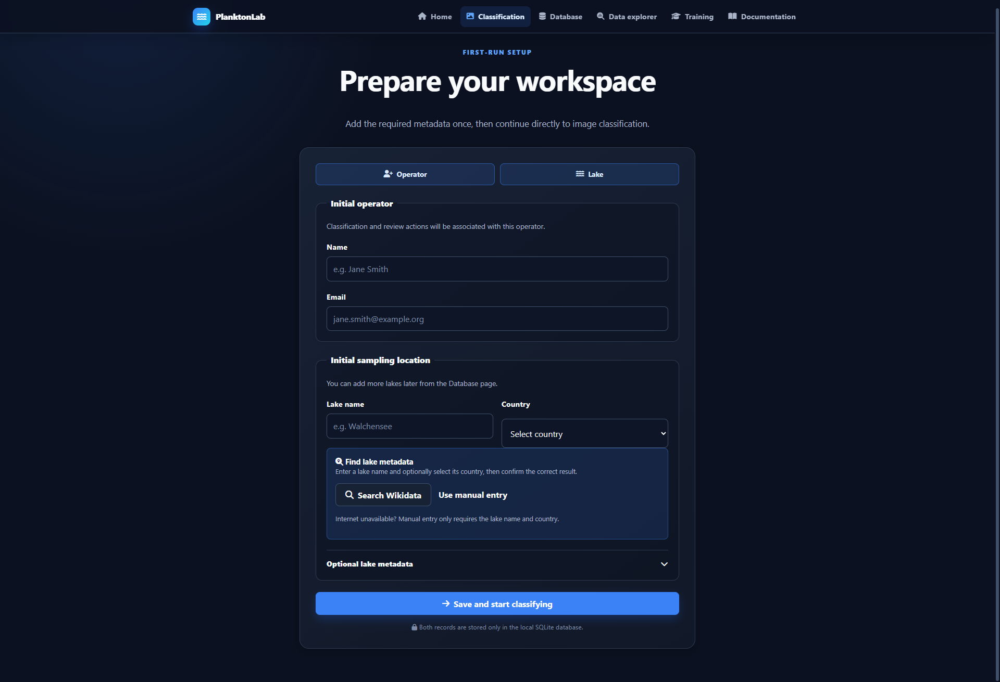

1. Enter the operator's name and email address. Classification and review activity
   can be associated with this person.
2. Enter a lake name and choose its country.
3. Optionally select **Search Wikidata** to find public lake metadata. Confirm the
   correct search result before using it.
4. If lookup is unavailable, select **Use manual entry**. Only lake name and country
   are required.
5. Expand **Optional lake metadata** to review or enter measurements.
6. Select **Save and start classifying**.

Imported metadata is a suggestion, not an authoritative laboratory record. Review
all values before saving. The operator and lake are stored in the local SQLite
database.

## 3. Understand the main workflow

The home screen links to every major area.

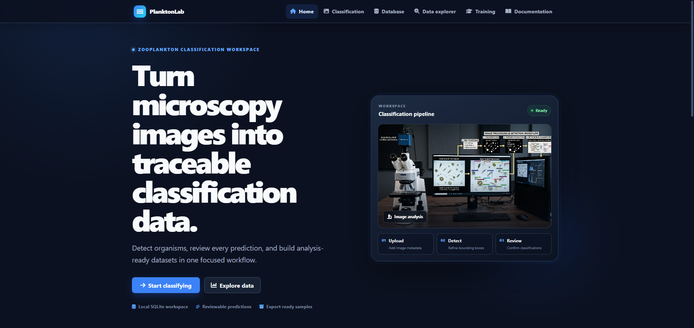

| Area | Use it for |
| --- | --- |
| **Classification** | Upload or reopen an image, detect objects, edit boxes, classify crops, and review labels. |
| **Database** | Inspect, add, edit, or delete application records. |
| **Data explorer** | Build joined queries visually or run guarded read-only SQL. |
| **Training** | Export labeled crops, follow the training guide, upload models, and select the active model. |
| **Documentation** | Read the technical API and route reference. |

The recommended operational sequence is:

1. Confirm operator, lake, and model information.
2. Upload an image with its sampling metadata.
3. Detect and correct bounding boxes.
4. Save box changes, classify the crops, and review the labels.
5. Explore or export the reviewed data.
6. Build a new training set when enough reviewed samples are available.

## 4. Add or reopen an image

Open **Classification** from the navigation bar.

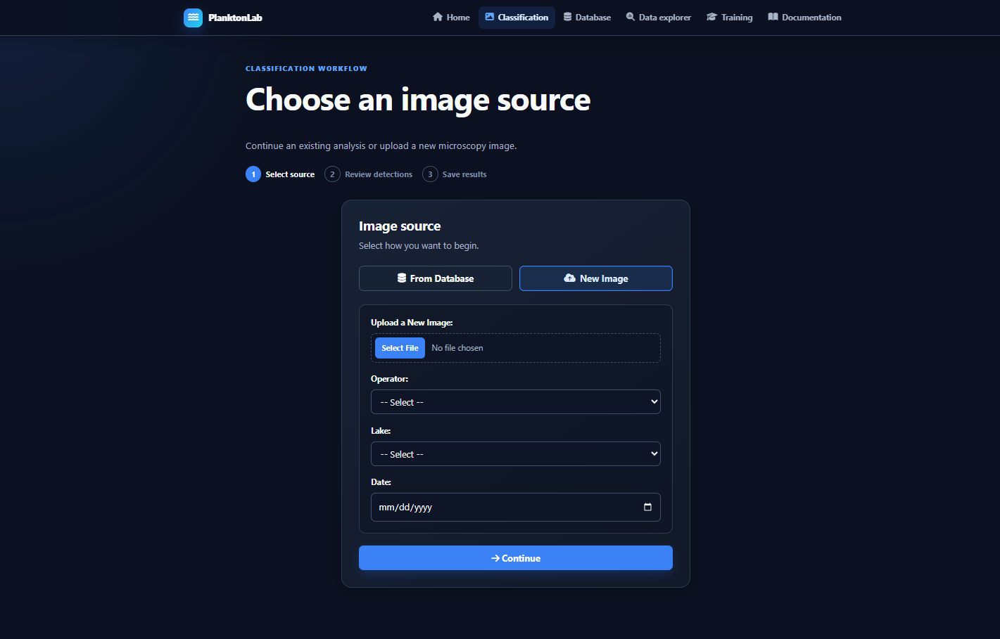

### New Image

1. Select **New Image**.
2. Select an image file.
3. Choose an **Operator** and **Lake**.
4. Enter the sampling **Date**.
5. Select **Continue**.

The file is copied into the PlanktonLab data directory and a sampling record is
created. Image names must be unique in the workspace; rename a file before upload if
that name already exists.

### From Database

1. Select **From Database**.
2. Choose an existing image by filename.
3. Select **Continue**.

This reopens its saved boxes and classifications. It does not create another sampling
record.

## 5. Detect and edit organisms

The classification workspace displays the source image, saved boxes, model selector,
zoom controls, and a bottom action bar.

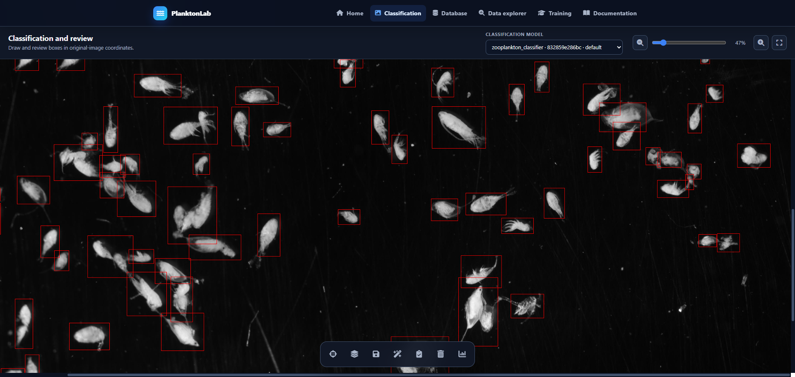

### Zoom and navigation

| Control | Behavior |
| --- | --- |
| **− / +** | Decrease or increase zoom by 10 percentage points. |
| **Zoom slider** | Set zoom from 10% to 300% in 5% steps. |
| **Fit** | Fit the full image into the available workspace. |
| **Ctrl/⌘ + mouse wheel** | Zoom around the pointer position. |
| Scrollbars | Pan around an image that is larger than the workspace. |

Zoom changes only the display. Box coordinates remain in original-image pixels.

### Box editing gestures

| Gesture | Result |
| --- | --- |
| Left-click and drag on empty image space | Add an `Unlabeled` box. Boxes smaller than 3×3 pixels are ignored. |
| Hover over a box | Show its label and confidence. |
| Double-click a box | Enter a manual label. |
| Right-click a box | Mark that box for deletion. |

### Bottom action bar

| Action | What it does |
| --- | --- |
| **Detect Boxes** | Rebuild the segmentation mask and propose boxes from the image. Review the proposals before saving. |
| **Show Mask / Show Image** | Toggle between the source image and segmentation mask. |
| **Save Changes** | Persist added, renamed, and deleted boxes without replacing labels through a full reclassification. |
| **Classify Image** | Classify every visible box with the selected model. A single progress dialog reports the current crop and total. |
| **Review Results** | Open the first taxon group awaiting review. It is enabled after classified samples exist. |
| **Remove All Boxes** | Clear every visible box. Select **Save Changes** afterward to persist the deletion. |
| **Show Summary** | Display a bar chart of current counts by label. Select a chart bar to open that taxon's review group. |

The **Classification model** menu selects the model for the current browser session.
If no model is available, manually labeled boxes can still be saved, but automated
classification is unavailable.

Important: **Detect Boxes** and **Remove All Boxes** change the browser workspace
first. Use **Save Changes** to persist the intended box set. Review the entire image
before saving a bulk deletion.

## 6. Classify and review results

Select **Classify Image** after the boxes are correct. Leave the progress dialog open
until it reports completion. The page then reloads with saved predictions and exact
model provenance.

### Review a taxon group

The gallery groups crops by their current classification. A check badge identifies
already reviewed crops, while the header reports how many still await review.

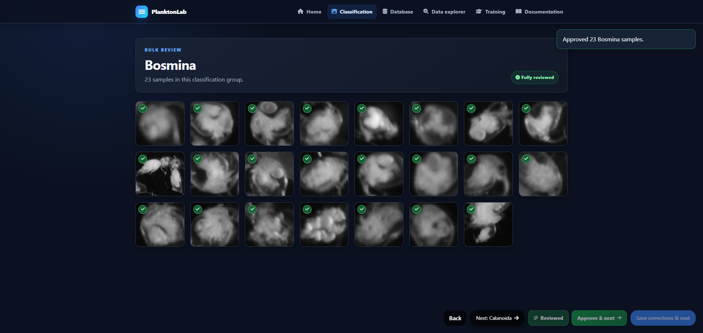

| Action | Behavior |
| --- | --- |
| Select a crop | Open the detailed preview. |
| **Approve group** | Accept every unreviewed crop in the current group. |
| **Approve & next** | Accept the group and move to the next group awaiting review. |
| **Next: _taxon_** | Move without approving the current group. |
| **Save corrections & next** | Save queued relabel/delete decisions and continue to the next group. |
| **Back** | Return to the source-image workspace. |

Approval and correction actions are recorded as review history. If all items are
already reviewed, approving the group makes no duplicate changes.

### Review one crop

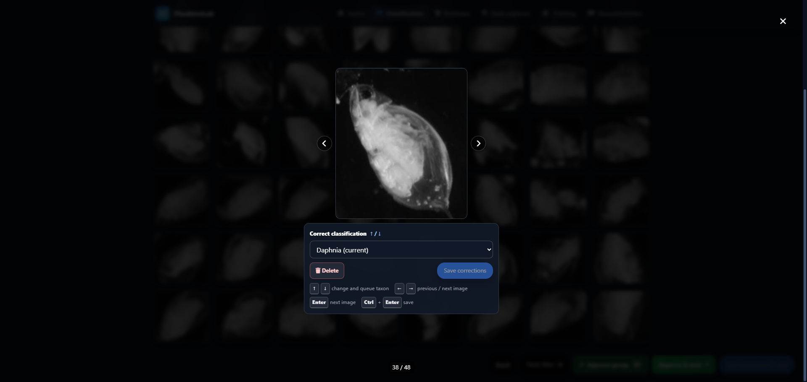

In the preview:

- Use the left and right buttons to move between crops.
- Choose **Correct classification** to queue another taxon.
- Select **Delete** to queue removal of the current crop and advance.
- Select **Save corrections** to persist queued changes.
- Close the modal with **×**, `Esc`, or a click outside it.

Keyboard shortcuts:

| Shortcut | Action |
| --- | --- |
| `↑` / `↓` | Cycle through taxa and queue the displayed label. |
| `←` / `→` | Previous or next crop. |
| `Enter` | Next crop. |
| `Ctrl/⌘ + Enter` | Save queued corrections. |
| `Esc` | Close the preview. |

Queued changes are visually marked but are not durable until saved.

## 7. Manage database records

The Database page exposes the current application tables.

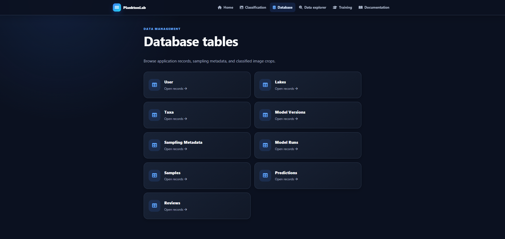

| Table | Contents |
| --- | --- |
| `user` | Operators. |
| `lakes` | Lake identity, measurements, coordinates, and lookup provenance. |
| `sampling_metadata` | Source image, operator, lake, date, and stored file path. |
| `taxa` | Normalized scientific/common names, rank, and optional parent. |
| `samples` | Crop coordinates, current label, confidence, image data, and review state. |
| `model_versions` | Immutable model version hashes, artifact locations, and default flag. |
| `model_runs` | Per-image model execution status and parameters. |
| `predictions` | Immutable model/import predictions for samples. |
| `reviews` | Accepted, corrected, or rejected human decisions. |

Open a table to view ten records per page. From a table page you can:

- add a record with **Add Entry**;
- edit a record while keeping its ID and audit timestamps server-managed;
- delete a record after confirmation; or
- move between pages when more than ten records exist.

Direct database forms are intended for informed maintenance. Foreign-key and unique
constraints can reject unsafe changes. Deleting a sampling record also removes its
dependent samples and runs; deleting a sample removes its prediction and review
history. Operators or lakes still referenced by sampling records cannot be deleted.
See [the ER diagram](ER_DIAGRAM.md) for every relationship and delete rule.

## 8. Add lake metadata

Open **Database → Lakes → Add Entry**.

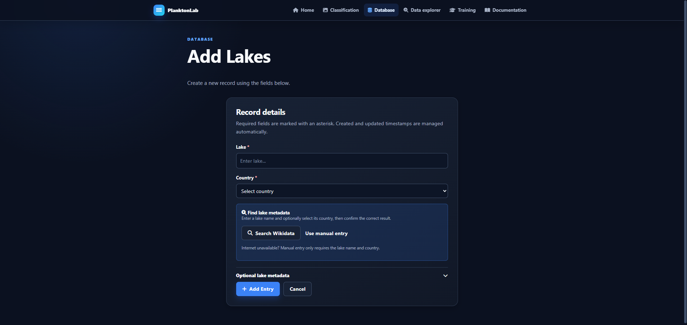

Lake name and country are required. The following values are optional and nullable:

- maximum and mean depth in metres;
- surface and catchment area in square kilometres;
- latitude and longitude;
- elevation in metres;
- volume in cubic kilometres;
- shoreline length in kilometres;
- residence time in days;
- waterbody type; and
- administrative region.

Measurements cannot be negative. Latitude must be between −90 and 90; longitude must
be between −180 and 180.

### Wikidata lookup

1. Enter the lake name and optionally choose its country.
2. Select **Search Wikidata**.
3. Compare the returned name, country, coordinates, and source link.
4. Select the correct result to populate available fields.
5. Expand **Optional lake metadata**, review every imported value, and save.

The lookup makes an outbound HTTPS request to Wikidata. It does not grant Wikidata
access to the local database or filesystem. The request can reveal the queried lake
name, IP/network metadata, and standard HTTP metadata to the service and corporate
network controls.

### Offline/manual entry

Select **Use manual entry**, provide a name and country, and optionally enter any
known measurements. No internet connection is required for manual entry.

## 9. Explore and export data

The Data explorer supports a visual query builder and guarded SQL.

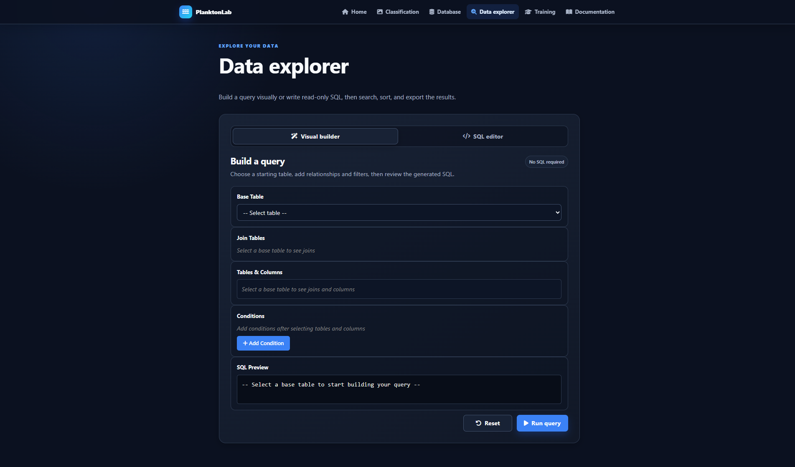

### Visual builder

1. Choose a **Base Table**.
2. Enable related tables under **Join Tables**. Only valid schema relationships are
   offered.
3. Select fields under **Tables & Columns**. With no explicit column selected for a
   table, its available columns are returned.
4. Select **Add Condition** and choose a table, column, operator, and value.
5. For multiple conditions, select `AND` or `OR`. Up to three opening and closing
   parentheses can group expressions.
6. Review **SQL Preview** and select **Run query**.

Condition operators are `=`, `!=`, `<`, `>`, `<=`, `>=`, and `LIKE`. **Reset** clears
the builder.

### SQL editor

Use the SQL editor for queries that are easier to express directly. Only one
read-only `SELECT` statement or a `SELECT`-based common table expression (`WITH`) is
accepted. Write operations, schema changes, pragmas, attached databases, and multiple
statements are rejected. Queries have a short execution timeout, and all matching
rows are returned.

Press `Ctrl/⌘ + Enter` or select **Run SQL**. Expand **Schema reference** to inspect
tables and columns without leaving the editor.

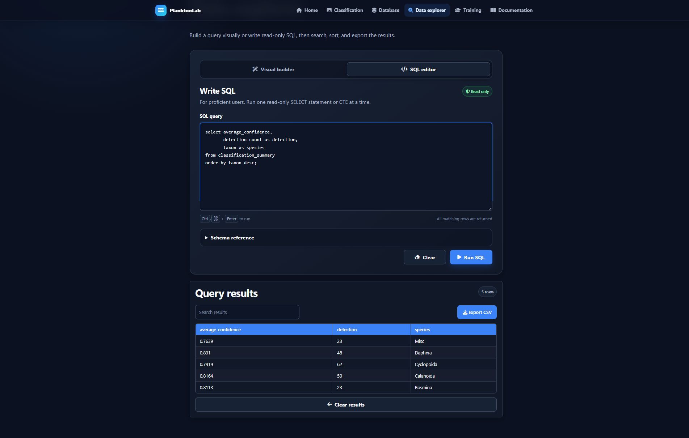

### Result tools

- Enter text in **Search results** to filter the returned rows in the browser.
- Select a column heading to sort ascending; select it again to sort descending.
- Results are displayed in pages of 35 rows.
- Select **Export CSV** to download the full filtered result set.
- Select **Clear results** to return to the query editor.

Use Database pages for controlled record changes; Data explorer SQL is deliberately
read-only.

## 10. Build a training dataset

The Training page summarizes reviewed samples, available taxa, and installed models.

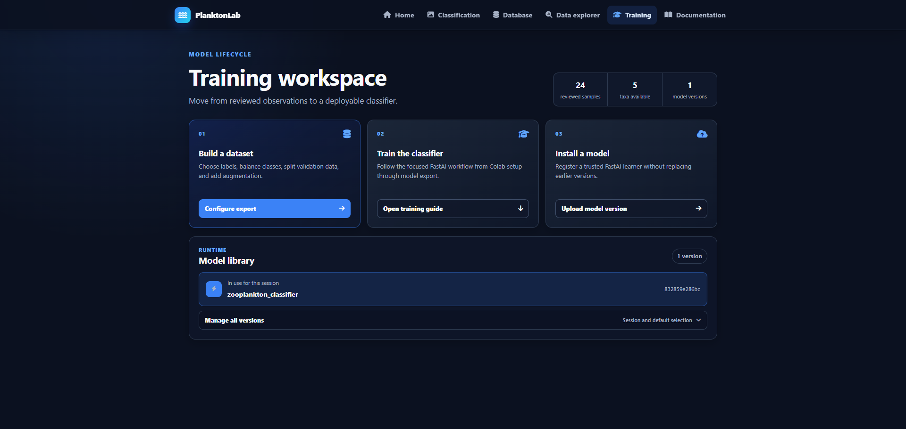

Select **Configure export** to open the dataset builder.

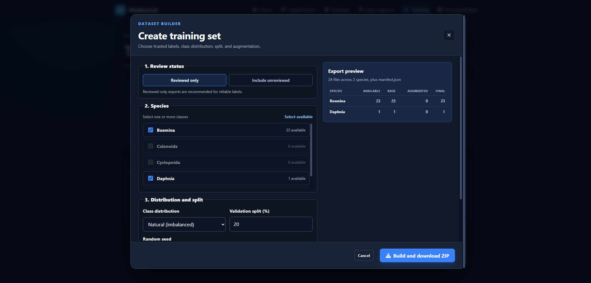

### Review status

- **Reviewed only** is the recommended default and excludes unverified labels.
- **Include unreviewed** makes all current sample labels available.

### Species

Select one or more enabled taxa. The available count updates when the review scope
changes. **Select available** checks every taxon with at least one eligible sample.

### Class distribution

| Option | Behavior |
| --- | --- |
| **Natural (imbalanced)** | Export each selected class at its available size. Optional augmentation copies multiply training images only. |
| **Balanced** | Set one target count for every selected class. Larger classes are sampled down; shortages require selected augmentation. |
| **Custom per species** | Set a separate target from 1 to 10,000 beside each selected class. Shortages require selected augmentation. |

### Split and reproducibility

- **Validation split** accepts 1–40%; the default is 20%.
- **Random seed** accepts 0–4,294,967,295; reuse it with the same data and options for
  a reproducible selection.
- Crops from the same source image are kept in the same split whenever possible to
  reduce data leakage.

### Augmentation

Available transformations are rotation, horizontal flip, vertical flip, brightness
and contrast, mild zoom, sensor noise, and mild blur.

For a natural export, **Extra augmented copies per training image** accepts 0–10.
Balanced and custom exports instead generate only enough augmented training crops to
reach the exact requested target. Validation images are not augmented.

The live preview reports available, base, augmented, and final counts. Resolve any
warning before selecting **Build and download ZIP**. The archive contains `train/`
and `valid/` class folders plus `manifest.json`, which records options and file
provenance.

## 11. Train and install a model

### Guided FastAI training

Select **Open training guide**. Its four steps cover:

1. configuring a GPU runtime in Google Colab, uploading the requirements file, and
   extracting the training ZIP;
2. creating FastAI data loaders and a ResNet-18 learner;
3. fitting, unfreezing, and refining the learner; and
4. exporting the trained learner as a `.pkl` file.

Use **Previous** and **Next** to move through the guide. Training occurs in Colab, not
inside the local PlanktonLab application.

### Upload a model

Select **Upload model version**.

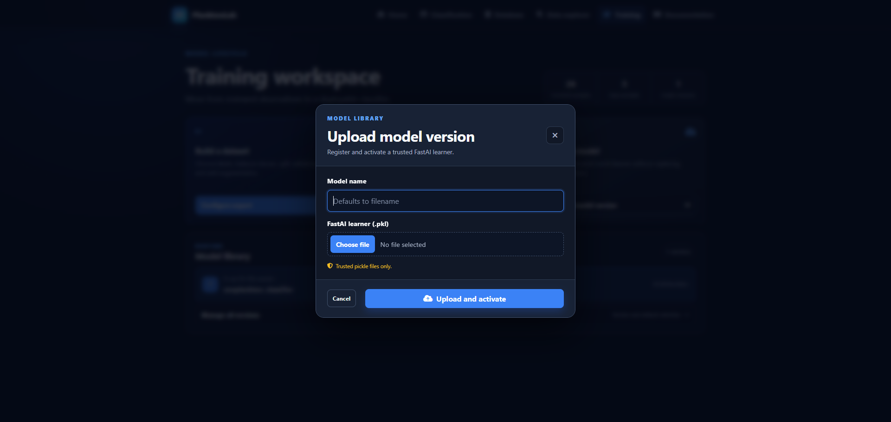

1. Enter an optional model name (maximum 120 characters). If omitted, the filename
   without `.pkl` is used.
2. Choose an exported FastAI `.pkl` learner.
3. Select **Upload and activate**.

The file is validated by loading it, hashed with SHA-256, stored by content hash, and
registered as a model version. A successful upload becomes both the current session
model and the global default.

Warning: pickle files can execute code during loading. Upload only models created by
you or obtained from a trusted, verified source.

### Manage installed versions

Expand **Manage all versions** in the Model library:

- **Use this session** changes the model only for the current browser session.
- **Set default** changes the fallback model for new sessions.
- **Default** identifies the global default.
- **In use** identifies the current session selection.

The classification page records the exact model version used for each run.

## 12. Data storage, backup, and security

By default, mutable data is stored outside the Git checkout:

| Operating system | Default location |
| --- | --- |
| Linux | `$XDG_DATA_HOME/PlanktonLab` or `~/.local/share/PlanktonLab` |
| macOS | `~/Library/Application Support/PlanktonLab` |
| Windows | `%LOCALAPPDATA%\PlanktonLab` |

The directory contains the SQLite database, uploaded source images, model artifacts,
and the local Flask session key. Back up the entire directory while PlanktonLab is
stopped so database and files remain consistent. `PLANKTONLAB_DATA_DIR` overrides the
location.

Security practices:

- Keep the default local-only listener unless network exposure has been explicitly
  approved and protected.
- Do not enable debug mode on a shared or exposed machine.
- Treat source images, operator details, and sampling metadata according to your
  organization's data-classification policy.
- Upload only trusted `.pkl` files.
- Keep TLS certificate verification enabled. Use the operating system certificate
  store rather than disabling verification.
- Review outbound Wikidata access with corporate network policy when applicable.

## 13. Troubleshooting

### Port 5000 is unavailable

Close the process using the port, or start PlanktonLab on another one:

```bash
PLANKTONLAB_PORT=5001 ./planktonlab
```

In PowerShell:

```powershell
$env:PLANKTONLAB_PORT = "5001"
.\planktonlab.cmd
```

### Dependency download reports `UnknownIssuer`

Use a current launcher and system certificates. For a development installation run:

```bash
uv --system-certs sync --frozen --extra cpu
```

Do not bypass TLS verification. If the error continues, ask corporate IT whether the
organization certificate authority is installed in the operating system trust store.

### Lake lookup is unavailable

Choose **Use manual entry** and provide at least lake name and country. Lookup failure
does not prevent local classification or database use.

### No classification model is available

Open **Training → Upload model version** and install a trusted FastAI `.pkl` learner.
You can still draw and save manually labeled boxes without a model.

### A model fails to load

Confirm that it is a valid FastAI learner exported as `.pkl`, that it came from a
trusted source, and that the stored artifact has not been moved or deleted. Re-upload
the valid export instead of manually editing its database path.

### Classification or review changes are missing

- Box edits require **Save Changes**.
- Classification requires **Classify Image** and must reach completion.
- Review relabel/delete decisions require **Save corrections** or **Save corrections
  & next**.

### An older database is incompatible

PlanktonLab creates the current schema but intentionally does not migrate older
schemas. Point `PLANKTONLAB_DATA_DIR` to a new directory and import or recreate the
required data explicitly.

## Further reference

- [API and route reference](API_REFERENCE.md)
- [Database ER diagram](ER_DIAGRAM.md)
- [Project README](../README.md)
